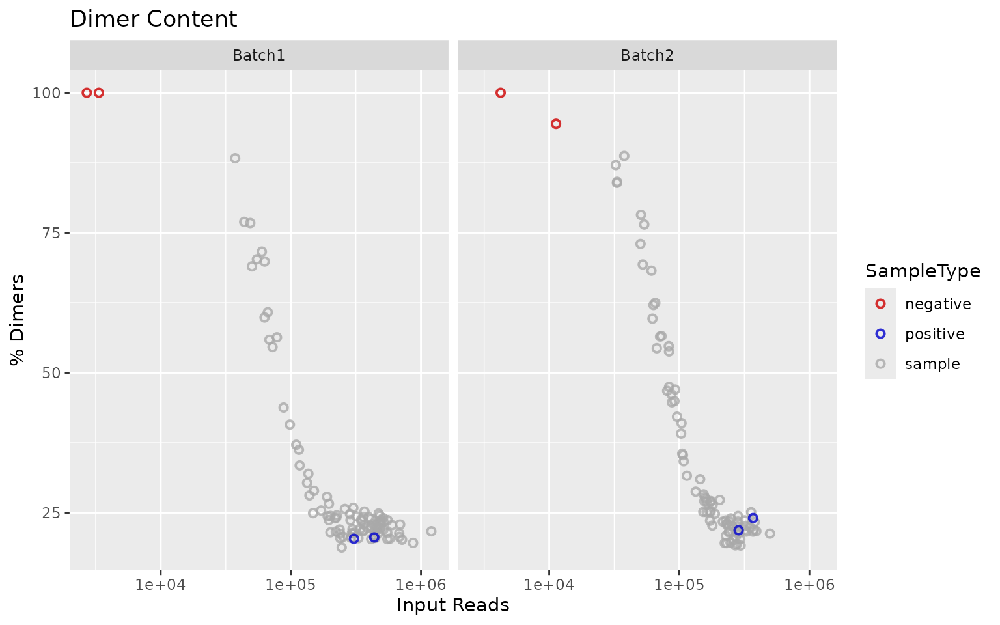
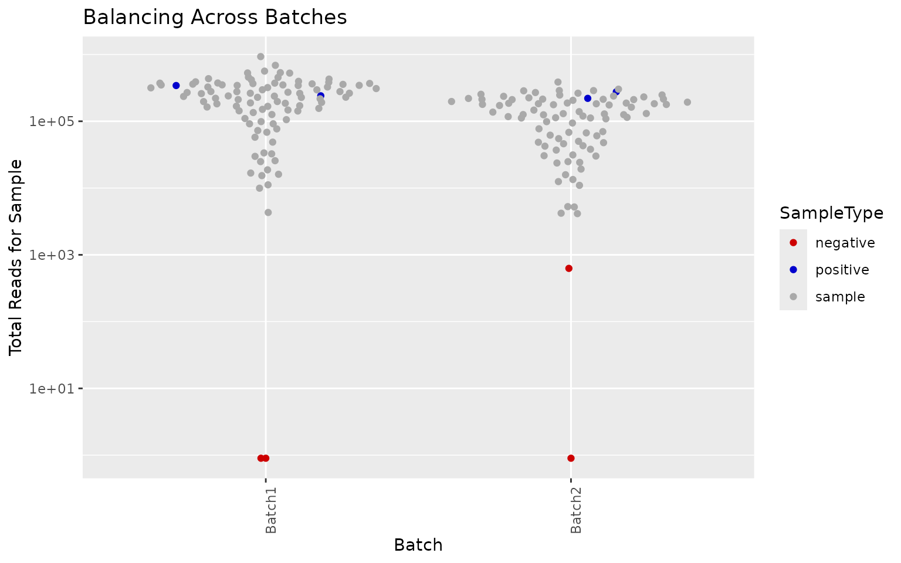
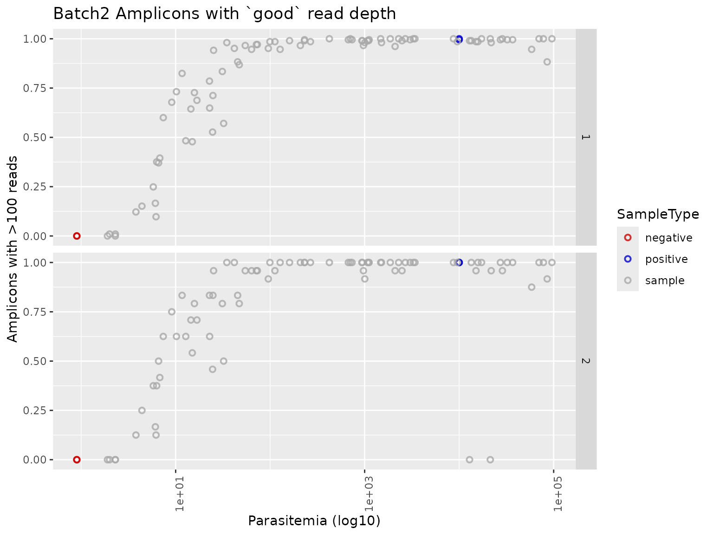
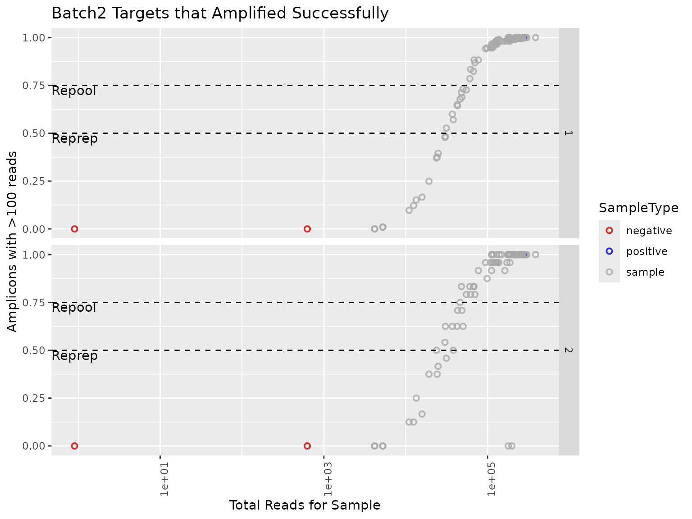
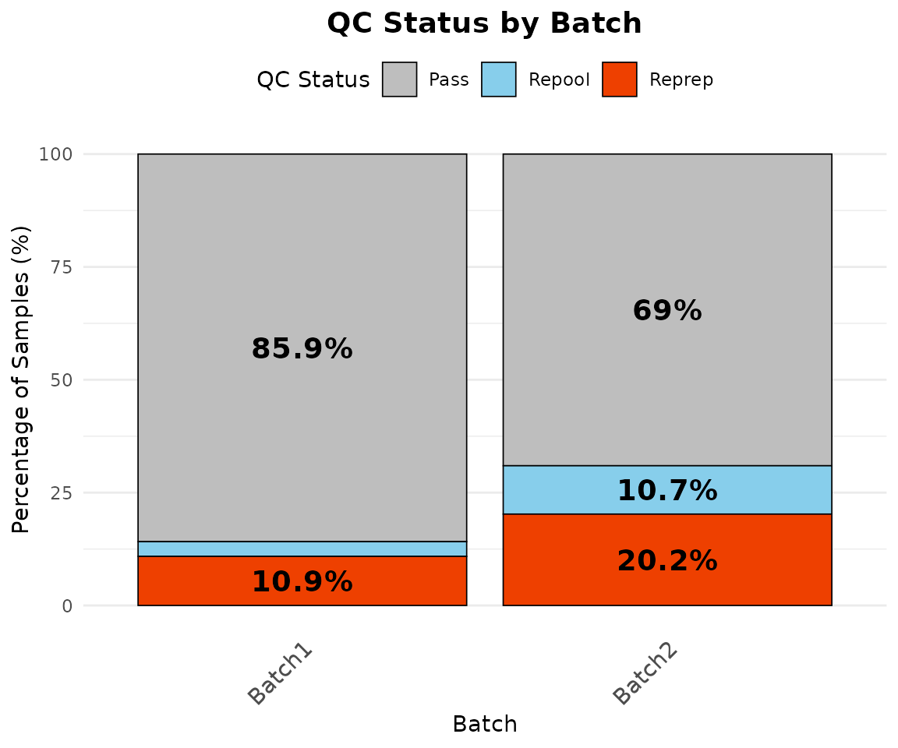
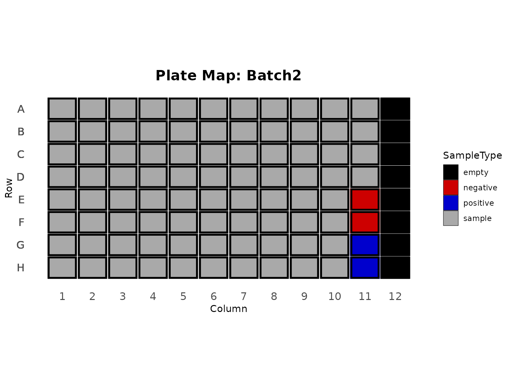
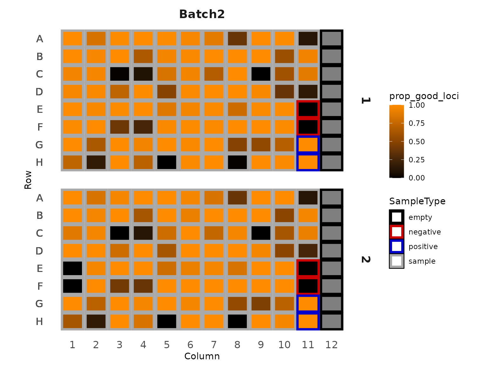
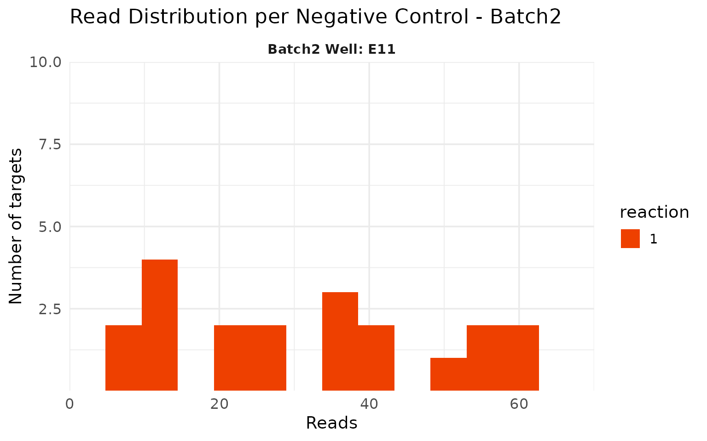
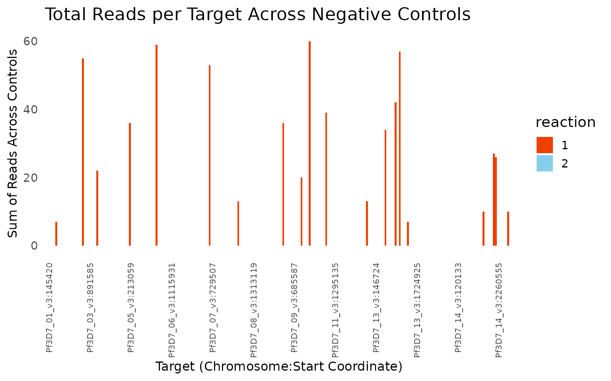

# Building a custom QC with the package functions

This page is for people who want to go beyond the standard report: run
parts of the QC on their own, change how steps work, or build their own
summaries and plots. If you just want the QC report, see
[`vignette("ampseqQC")`](https://eppicenter.github.io/ampseq-qc/preview/pr-25/articles/ampseqQC.md).

Every step of the report is an exported function. This page walks
through them in the order the report uses them, on the example run
included with the package.

## The example run

The package includes a simulated run of the MAD4HatTeR panel, run with
Mad4hatter’s `--pools D1,R1,R2`. D1 and R1 were amplified in one mPCR
reaction and R2 in a second. The run has two batches, each on its own
96-well plate with 2 positive controls (3D7) and 2 negative controls.
Batch1 fills the plate with 92 samples; Batch2 has 84 samples and column
12 left empty. The data is simulated from the real MAD4HatTeR panel
information, so target names, pools and target lengths match a real run.

``` r

library(ampseqQC)
library(dplyr, warn.conflicts = FALSE)

tutorial_dir <- system.file("extdata", "tutorial", package = "ampseqQC")
results_dir <- file.path(tutorial_dir, "results")
manifest_file <- file.path(tutorial_dir, "manifest.csv")

list.files(results_dir, recursive = TRUE)
#> [1] "allele_data.txt"                     "amplicon_coverage.txt"              
#> [3] "panel_information/amplicon_info.tsv" "sample_coverage.txt"
```

## Loading the data

The manifest describes each well:

``` r

manifest <- read_manifest(manifest_file)
head(manifest)
#>   sample_name SampleType  Batch Column Row Parasitemia
#> 1      B1_S01     sample Batch1      1   A      6788.9
#> 2      B1_S02     sample Batch1      1   B         1.3
#> 3      B1_S03     sample Batch1      1   C        11.1
#> 4      B1_S04     sample Batch1      1   D       453.2
#> 5      B1_S05     sample Batch1      1   E     16954.5
#> 6      B1_S06     sample Batch1      1   F     39949.5
count(manifest, Batch, SampleType)
#>    Batch SampleType  n
#> 1 Batch1   negative  2
#> 2 Batch1   positive  2
#> 3 Batch1     sample 92
#> 4 Batch2   negative  2
#> 5 Batch2   positive  2
#> 6 Batch2     sample 84
```

[`read_mad4hatter_results()`](https://eppicenter.github.io/ampseq-qc/preview/pr-25/reference/read_mad4hatter_results.md)
reads the pipeline outputs and removes the parts the sequencer adds to
FASTQ names (the sample number and lane, for example `B1_S01_S1_L001`
becomes `B1_S01`) so they match the manifest. Passing the manifest
sample names stops names that already match from being trimmed:

``` r

results <- read_mad4hatter_results(results_dir, manifest_sample_names = manifest$sample_name)
names(results)
#> [1] "sample_coverage"                "amplicon_coverage"             
#> [3] "allele_data"                    "panel_information"             
#> [5] "collapsed_allele_data"          "resmarker_table"               
#> [7] "resmarker_microhaplotype_table"
head(results$amplicon_coverage)
#>   sample_name                 target_name reads OutputDada2
#> 1      B1_S01  PKNH_12_v2-0198893-0199083     1           0
#> 2      B1_S01 Pf3D7_01_v3-0145420-0145630  3330        3085
#> 3      B1_S01 Pf3D7_01_v3-0162888-0163092   427         350
#> 4      B1_S01 Pf3D7_01_v3-0181544-0181729  1318        1152
#> 5      B1_S01 Pf3D7_01_v3-0194763-0194942   825         694
#> 6      B1_S01 Pf3D7_01_v3-0455826-0456021  2329        2142
#>   OutputPostprocessing
#> 1                    0
#> 2                 3002
#> 3                  348
#> 4                 1151
#> 5                  674
#> 6                 2134
```

[`check_sample_names()`](https://eppicenter.github.io/ampseq-qc/preview/pr-25/reference/sample_name_mismatches.md)
compares the manifest with the amplicon coverage, which contains every
sample that went through the pipeline. It stops if no names match and
warns about samples that are only on one side. Here every sample
matches, so there is no warning:

``` r

check_sample_names(manifest, results$amplicon_coverage)
```

## Pools and reactions

The pools in the run are read from the panel information and mapped to
reactions using the panel settings. The defaults cover the MAD4HatTeR
and PfPHAST pools:

``` r

default_panel_settings()
#> <ampseqQC panel settings>
#> Pool -> reaction:
#>   1: D1, D1.1, 1A, R1, R1.1, R1.2, 1B, 5, M1, M1.1, M1.addon
#>   2: R2, R2.1, 2, M2, M2.1
#> Targets excluded from QC: 14
summarise_pools(results$panel_information)
#> # A tibble: 3 × 3
#>   pool  reaction n_targets
#>   <chr> <chr>        <int>
#> 1 D1    1              170
#> 2 R1    1               47
#> 3 R2    2               31
```

Targets shared by pools in different reactions are counted in each
reaction. In this run two targets are in both R1 and R2:

``` r

panel_reactions <- assign_reactions(results$panel_information)
panel_reactions |>
  count(target_name) |>
  filter(n > 1)
#>                   target_name n
#> 1 Pf3D7_13_v3-2841410-2841661 2
#> 2 Pf3D7_13_v3-2844354-2844599 2
```

If your run uses pools that aren’t in the settings, or a different
reaction layout, add them with
[`panel_settings()`](https://eppicenter.github.io/ampseq-qc/preview/pr-25/reference/panel_settings.md).
Pools without a reaction stop the QC rather than being guessed:

``` r

bespoke_panel <- results$panel_information |>
  mutate(pool = ifelse(pool == "R2", "myPool", pool))
assign_reactions(bespoke_panel)
#> Error:
#> ! No reaction is defined for pool(s): myPool.
#> Supply the reaction for each pool with panel_settings(), e.g. panel_settings(c("myPool" = "1"), base = default_panel_settings())

settings <- panel_settings(c(myPool = "2"), base = default_panel_settings())
assign_reactions(bespoke_panel, settings) |>
  count(reaction)
#>   reaction   n
#> 1        1 214
#> 2        2  31
```

## Targets excluded from QC

Species identification targets and long targets are left out of the QC
calculations, because they are not expected to amplify in every sample.
They are still kept in the filtered allele tables.

``` r

excluded <- qc_excluded_targets(results$panel_information, long_target_threshold = 275)
excluded$long
#> [1] "Pf3D7_02_v3-0320675-0320924" "Pf3D7_03_v3-0240989-0241224"
#> [3] "Pf3D7_05_v3-0615411-0615646" "Pf3D7_06_v3-0857486-0857720"
#> [5] "Pf3D7_11_v3-1294305-1294547" "Pf3D7_13_v3-1465035-1465280"
#> [7] "Pf3D7_13_v3-2840473-2840721" "Pf3D7_13_v3-2841410-2841661"
#> [9] "Pf3D7_13_v3-2844354-2844599"
intersect(excluded$excluded, results$panel_information$target_name)
#>  [1] "Pf3D7_13_v3-1041624-1041829"   "PmUG01_12_v1-1398020-1398213" 
#>  [3] "PocGH01_12_v1-1106482-1106671" "PvP01_12_v1-1185007-1185184"  
#>  [5] "PKNH_12_v2-0198893-0199083"    "Pf3D7_02_v3-0320675-0320924"  
#>  [7] "Pf3D7_03_v3-0240989-0241224"   "Pf3D7_05_v3-0615411-0615646"  
#>  [9] "Pf3D7_06_v3-0857486-0857720"   "Pf3D7_11_v3-1294305-1294547"  
#> [11] "Pf3D7_13_v3-1465035-1465280"   "Pf3D7_13_v3-2840473-2840721"  
#> [13] "Pf3D7_13_v3-2841410-2841661"   "Pf3D7_13_v3-2844354-2844599"

panel_reactions <- panel_reactions |>
  filter(!target_name %in% excluded$excluded)
amplicon_coverage_qc <- results$amplicon_coverage |>
  filter(!target_name %in% excluded$excluded)

nloci_table <- count_targets_per_reaction(panel_reactions)
nloci_table
#>   reaction nreactionloci
#> 1        1           205
#> 2        2            24
```

## Amplification success per sample

A target is successfully amplified if it has more than `read_threshold`
reads.
[`summarise_samples()`](https://eppicenter.github.io/ampseq-qc/preview/pr-25/reference/summarise_samples.md)
gives the proportion of targets amplified per sample and reaction.

``` r

amplicon_coverage_with_manifest <- merge_amplicon_coverage(amplicon_coverage_qc, manifest, panel_reactions)
summary_samples <- summarise_samples(amplicon_coverage_with_manifest, nloci_table, manifest, read_threshold = 100)

summary_samples |>
  select(sample_name, Batch, reaction, reads_per_reaction, n_good_loci, prop_good_loci) |>
  head()
#> # A tibble: 6 × 6
#>   sample_name Batch  reaction reads_per_reaction n_good_loci prop_good_loci
#>   <chr>       <chr>  <chr>                 <int>       <int>          <dbl>
#> 1 B1_NEG1     Batch1 1                         0           0              0
#> 2 B1_NEG1     Batch1 2                         0           0              0
#> 3 B1_NEG2     Batch1 1                         0           0              0
#> 4 B1_NEG2     Batch1 2                         0           0              0
#> 5 B1_POS1     Batch1 1                    305733         205              1
#> 6 B1_POS1     Batch1 2                     37249          24              1
```

Primer dimers make up most of the reads in low-density samples and in
negative controls:

``` r

sample_coverage_with_manifest <- merge_sample_coverage(results$sample_coverage, manifest)
generate_dimer_plot(sample_coverage_with_manifest)
```



Batch2 was sequenced less deeply than Batch1:

``` r

generate_balancing_plot(summary_samples)
```



Amplification success increases with parasitemia and read depth. The
dashed lines show the reprep and repool thresholds.

``` r

generate_parasitemia_by_amplification_success_plots(summary_samples, threshold = 100)$Batch2
```



``` r

generate_reads_by_amplification_success_plots(summary_samples, read_threshold = 100)$Batch2
#> Warning in ggplot2::scale_x_log10(): log-10 transformation introduced infinite values.
#> log-10 transformation introduced infinite values.
```



## QC calls

Samples are classified per reaction: below `reprep_threshold` of targets
amplified they need re-prep, below `repool_threshold` they need re-pool.
Samples in the manifest with no data are marked for reprep. Negative
controls are not classified.

``` r

qc_calls <- generate_reprep_repool_table(summary_samples, reprep_threshold = 0.5, repool_threshold = 0.75) |>
  fill_missing_data(manifest)

qc_calls |>
  filter(status != "pass") |>
  arrange(Batch, sample_name, reaction)
#> # A tibble: 73 × 8
#>    sample_name Batch  SampleType reaction status reason       reads_per_reaction
#>    <chr>       <chr>  <chr>      <chr>    <chr>  <chr>                     <dbl>
#>  1 B1_S02      Batch1 sample     1        reprep < reprep th…              13661
#>  2 B1_S02      Batch1 sample     2        reprep < reprep th…               1692
#>  3 B1_S03      Batch1 sample     1        repool < repool th…              30071
#>  4 B1_S03      Batch1 sample     2        repool < repool th…               3535
#>  5 B1_S12      Batch1 sample     1        reprep < reprep th…              16866
#>  6 B1_S12      Batch1 sample     2        reprep < reprep th…               1871
#>  7 B1_S20      Batch1 sample     1        reprep < reprep th…              15019
#>  8 B1_S20      Batch1 sample     2        reprep < reprep th…               1751
#>  9 B1_S24      Batch1 sample     1        reprep < reprep th…               9005
#> 10 B1_S24      Batch1 sample     2        reprep < reprep th…                947
#> # ℹ 63 more rows
#> # ℹ 1 more variable: prop_good_loci <dbl>
```

A few things stand out. Low-parasitemia samples fail in both reactions.
B2_S05 and B2_S06 amplified well in reaction 1 but not in reaction 2,
which points to a problem with the reaction 2 mPCR for those wells
rather than with the samples.

The overall pass rate by batch excludes controls. Each sample is counted
once, by its worst status across reactions, so B2_S05 and B2_S06 count
as reprep even though reaction 1 passed:

``` r

qc_summary_table(qc_calls)
#> # A tibble: 2 × 6
#>   Batch   pass repool reprep total pass_rate
#>   <chr>  <int>  <int>  <int> <int>     <dbl>
#> 1 Batch1    79      3     10    92      85.9
#> 2 Batch2    58      9     17    84      69
qc_summary_by_batch(qc_calls) |>
  plot_qc_status_by_batch()
```



Plate maps show where samples and controls are on each plate, and help
spot problems with particular wells or regions of the plate. Empty
wells, such as column 12 of the Batch2 plate, are shown in black:

``` r

quadrants <- create_plate_template(summary_samples, unique(summary_samples$Batch))
plot_plate_layouts(quadrants)$Batch2
```



``` r


plot_plate_heat_maps(
  summary_samples, quadrants,
  fill_param = "prop_good_loci", scale_midpoint = 0.5, scale_label = "prop_good_loci"
)$Batch2
```



## Positive controls

The positive controls are monoclonal 3D7, so each target should have a
single allele. A small number of targets with a low-frequency second
allele (here PCR errors at 2 to 4% frequency) is expected; many would
suggest contamination.

``` r

allele_data_qc <- results$allele_data |>
  filter(!target_name %in% excluded$excluded) |>
  add_allele_frequency()

positive_controls <- summarise_positive_controls(allele_data_qc, manifest, read_filter = 0, af_filter = 0.01)
positive_controls$category_counts
#> # A tibble: 8 × 3
#>   sample_name Category    Count
#>   <chr>       <chr>       <int>
#> 1 B1_POS1     2 Alleles       4
#> 2 B1_POS1     Monoallelic   225
#> 3 B1_POS2     2 Alleles       2
#> 4 B1_POS2     Monoallelic   227
#> 5 B2_POS1     2 Alleles       3
#> 6 B2_POS1     Monoallelic   226
#> 7 B2_POS2     2 Alleles       3
#> 8 B2_POS2     Monoallelic   226

positive_controls$polyclonal_information |>
  select(sample_name, target_name, reads, AlleleFreq)
#> # A tibble: 24 × 4
#>    sample_name target_name                 reads AlleleFreq
#>    <chr>       <chr>                       <int>      <dbl>
#>  1 B1_POS1     Pf3D7_05_v3-0668787-0668979   406     0.969 
#>  2 B1_POS1     Pf3D7_05_v3-0668787-0668979    13     0.0310
#>  3 B1_POS1     Pf3D7_07_v3-0405597-0405815   606     0.970 
#>  4 B1_POS1     Pf3D7_07_v3-0405597-0405815    19     0.0304
#>  5 B1_POS1     Pf3D7_14_v3-0421354-0421514  2945     0.961 
#>  6 B1_POS1     Pf3D7_14_v3-0421354-0421514   121     0.0395
#>  7 B1_POS1     Pf3D7_14_v3-1392869-1393059   968     0.972 
#>  8 B1_POS1     Pf3D7_14_v3-1392869-1393059    28     0.0281
#>  9 B1_POS2     Pf3D7_01_v3-0455826-0456021   621     0.979 
#> 10 B1_POS2     Pf3D7_01_v3-0455826-0456021    13     0.0205
#> # ℹ 14 more rows
```

Raising the allele frequency filter removes these low-frequency alleles:

``` r

summarise_positive_controls(allele_data_qc, manifest, af_filter = 0.05)$polyclonal_information
#> # A tibble: 0 × 7
#> # ℹ 7 variables: sample_name <chr>, target_name <chr>,
#> #   pseudocigar_masked <chr>, reads <int>, AlleleFreq <dbl>,
#> #   NumASVs_Meeting_Threshold <int>, Category <chr>
```

## Negative controls

Negative controls should have few or no reads. B2_NEG1 has low-level
reads at several D1 targets:

``` r

amplicons_negative <- negative_control_amplicons(amplicon_coverage_with_manifest)
negative_control_targets_over_threshold(amplicons_negative, negative_control_read_threshold = 50)
#>   sample_name                 target_name OutputPostprocessing
#> 1     B2_NEG1 Pf3D7_03_v3-0653993-0654177                   55
#> 2     B2_NEG1 Pf3D7_05_v3-1322131-1322313                   59
#> 3     B2_NEG1 Pf3D7_07_v3-0729507-0729725                   53
#> 4     B2_NEG1 Pf3D7_11_v3-0115945-0116151                   60
#> 5     B2_NEG1 Pf3D7_13_v3-1233117-1233299                   57

plot_negative_control_histogram(amplicons_negative |> filter(Batch == "Batch2"), batch_name = "Batch2")
```



Summing reads per target across negative controls shows which targets
are affected. Like the histogram, this uses the final reads after DADA2
and post-processing (`OutputPostprocessing`). In the report this plot is
interactive.

``` r

summarise_negative_control_targets(amplicons_negative, results$panel_information) |>
  plot_negative_control_target_reads()
```



## Output tables

The allele tables written by the report keep all targets, including
those excluded from QC, and are filtered by reads and within-sample
allele frequency:

``` r

allele_data_filtered <- filter_allele_table(
  results$allele_data,
  group_cols = allele_table_group_cols()$allele_data,
  read_filter = 0,
  af_filter = 0.01
)
nrow(results$allele_data)
#> [1] 57960
nrow(allele_data_filtered)
#> [1] 57960
```

Mad4hatter only writes samples with at least one final allele to the
allele table, so clean negative controls are missing from it, as are any
samples that were not sequenced:

``` r

samples_missing_from_allele_data(manifest, results$sample_coverage, results$allele_data)
#>   sample_name  Batch SampleType                                     reason
#> 1     B1_NEG1 Batch1   negative No alleles after DADA2 and post-processing
#> 2     B1_NEG2 Batch1   negative No alleles after DADA2 and post-processing
#> 3     B2_NEG2 Batch2   negative No alleles after DADA2 and post-processing
```

## Customising the report itself

To change the report layout rather than individual steps, copy the
Quarto template that
[`render_qc_report()`](https://eppicenter.github.io/ampseq-qc/preview/pr-25/reference/render_qc_report.md)
uses and edit it:

``` r

file.copy(qc_report_template(), "my_QC_report.qmd")
```
